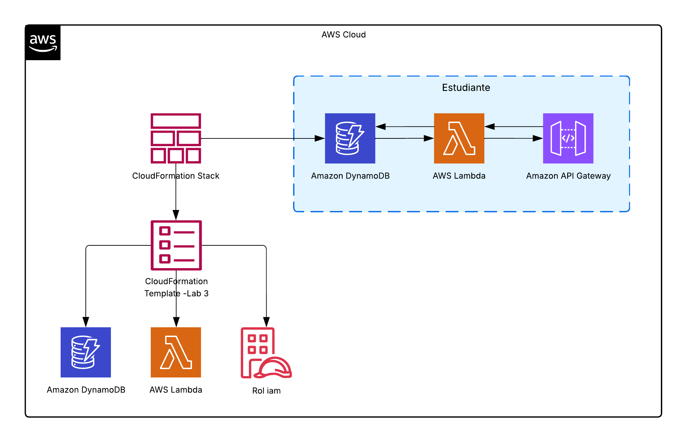
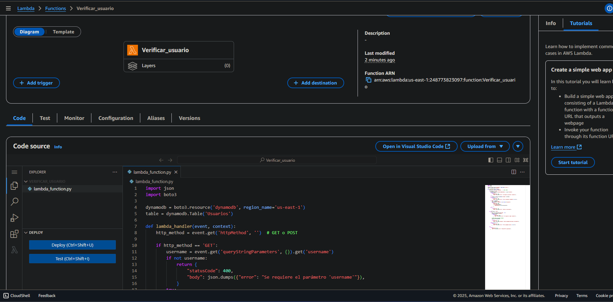
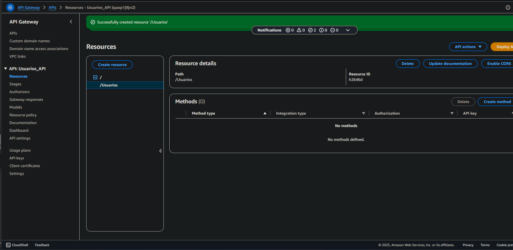
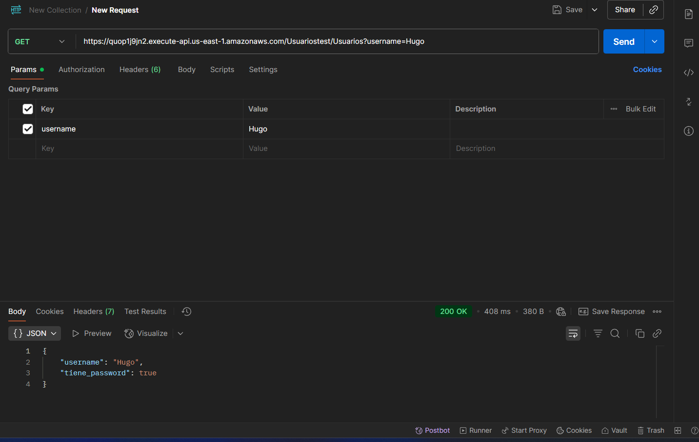

# AWS Serverless User Management API

## Objective

Design and implement a fully serverless REST API on AWS for user management, demonstrating practical experience with **DynamoDB**, **Lambda**, and **API Gateway** while applying production-ready patterns for security and scalability.

## Business Use Case

This project models a lightweight user profile and credential-check API that could be used as the backend for:

- A customer portal that needs to verify whether a user has completed onboarding (password set, profile created).
- An internal admin console that allows support teams to quickly check user status and register new accounts.
- A mobile or web application that delegates user storage to a serverless backend to avoid managing servers.

The same pattern can easily extend to other domains such as library books, orders, or subscriptions by changing the data model and Lambda logic.

## Architecture

### System Components

| Component | Purpose |
|-----------|---------|
| Amazon DynamoDB | NoSQL database storing user records with sub-millisecond latency |
| AWS Lambda | Serverless compute executing business logic in Python 3.x |
| API Gateway | RESTful API interface with request/response transformation |
| IAM Role | Least-privilege security model for Lambda-DynamoDB access |

  
   
  Application Architecture 

## Implementation Summary

### Data and Security Setup

- Reviewed and used a DynamoDB table named `Usuarios` with 20 sample user records and `username` as the partition key.
- Validated an IAM role `LambdaExecutionRole` with permissions for DynamoDB read/write operations.
- Confirmed an initialization Lambda `ConfigUsuarios` to seed the `Usuarios` table.

### Lambda Function

- Created a new Lambda function using Python 3.x runtime.
- Attached the `LambdaExecutionRole` to enforce least-privilege access to DynamoDB.
- Implemented a single handler supporting:
  - **GET**: Check if a user exists and whether they have a password.
  - **POST**: Insert a new user item into the `Usuarios` table based on a JSON payload.
- Used the `boto3` SDK to read/write items in DynamoDB and return structured JSON responses.

  
   
  Lambda Handler 

### API Gateway

- Created a REST API and defined the `/Usuarios` resource.

  
   
  API Resource creation

- Configured:
  - **GET method** with query string parameter `username`.
  - **POST method** accepting a JSON body for user creation.
- Enabled Lambda proxy integration to simplify mapping between HTTP payloads and Lambda events.
- Deployed the API to a stage (for example: `prod`) and obtained a public invoke URL.
- Enabled CORS to support browser and tooling access.

## Validation

  
   
  Postman Validation 

## Key Learnings

- How to design a small but complete serverless backend that separates concerns across API Gateway, Lambda, and DynamoDB.
- How to use IAM roles to securely connect Lambda to DynamoDB without embedding credentials in code.
- How Lambda proxy integration simplifies request/response handling by passing full HTTP payloads to your function.
